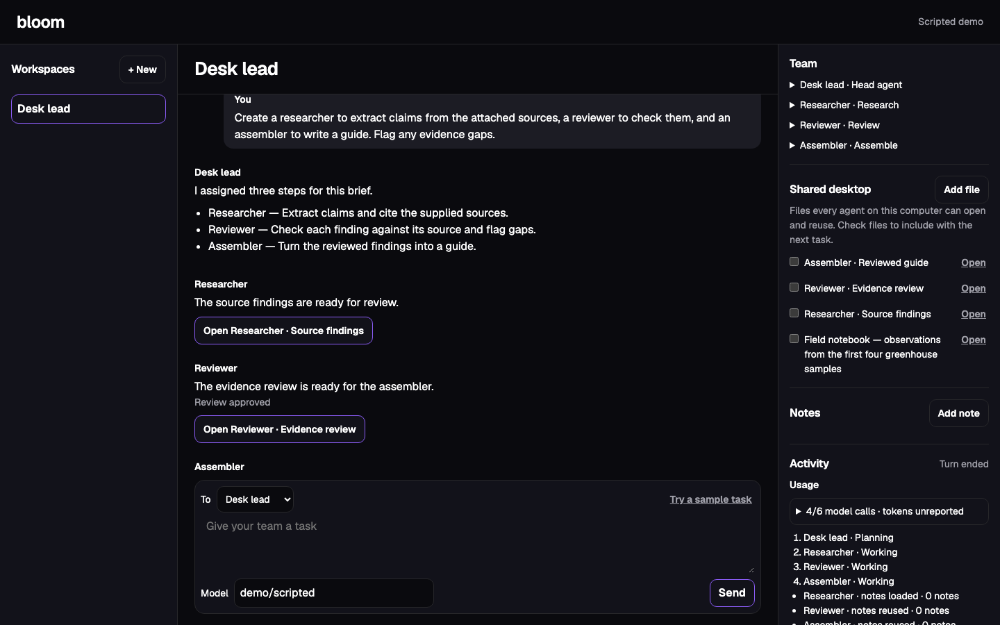

# Bloom

Give a head agent a brief and watch a team work through it in one group conversation. Specialists can research public sources, review the findings, and assemble a Markdown guide. Each contribution is a file on a shared desktop that you can open, attach to another task, or download.

[Download the latest release](https://github.com/Vidoxlabs/bloom/releases/latest) · [View the phone layout](docs/previews/phone.png)



## Try it

Download `bloom-VERSION.zip` from the [latest release](https://github.com/Vidoxlabs/bloom/releases/latest) and extract it, or clone this repository. Install Node.js 22.13 or newer and run this command from the project folder in a terminal on macOS, Linux, or Windows. The app has no npm runtime dependencies.

```sh
npm run demo
```

Open **http://127.0.0.1:4317**, choose **Create a team** and give the head agent a name. Use **Add file** to paste some project notes, select **Try a sample task**, and send it. Open the assembler’s file in the group chat. The demo is scripted and requires no key. Its outputs and usage display identify it as a demonstration.

## Connect OpenCode

| Connection | Start Bloom | What runs |
| --- | --- | --- |
| OpenCode Console | Set `OPENCODE_API_KEY` in the environment, then run `npm start`. Enter a supported **paid** text model ID in the team form. | The team calls OpenCode’s chat completions HTTP API. Each team uses the model you select. |
| Local OpenCode 1.x server | In a dedicated empty directory, run `opencode serve --hostname 127.0.0.1 --port 4096`. In Bloom’s directory, run `npm start -- --opencode-server http://127.0.0.1:4096`. | The head and each model-backed specialist use a fresh OpenCode session. Set `provider/model` in Bloom or use the server default. Session tool permissions are denied. Bloom handles evidence reads and file handoffs. |
| Other chat-completions providers | Run `npm start -- --api-base http://127.0.0.1:8000/v1 --team-model local-model` with your server’s address and model. For a hosted endpoint use HTTPS and set `BLOOM_API_KEY` if needed. | Bloom uses the same team and memory logic with an OpenAI-compatible HTTP service. |
| Coding session | Run `npm start`, then choose **Create a coding session** and select a workspace. | OpenCode runs locally over ACP using its configured providers, supports tool approvals (**Allow once**, **Always allow** when OpenCode offers it, or **Reject**) and resumes the saved conversation. |

The hosted API uses `https://opencode.ai/inference/openai/v1/chat/completions`. Configure credentials in the server’s environment. An authenticated OpenCode 1.x server uses `OPENCODE_SERVER_USERNAME` and `OPENCODE_SERVER_PASSWORD`. Team HTTP calls send the brief and admitted evidence to the selected model. The console model catalog identifies supported models and billing. OpenCode's newer experimental server has a different API. [Console API](https://opencode.ai/docs/console/api/inference/) · [Model catalog](https://opencode.ai/docs/console/models/) · [ACP](https://opencode.ai/docs/cli/acp/)

## Work with a team

- **Assign work.** Set the head agent’s **Jurisdiction** and describe the deliverable. The head creates named specialists with jurisdictions and voices at runtime. Select a recipient or type `@Reviewer: check the latest draft` for a direct assignment in the group. A review verdict of “revise” pauses assembly. Address the author with the requested changes and attach the review when continuing.
- **Share evidence.** Paste up to three public HTTPS URLs in a brief or use **Add file** on the **Shared desktop** for a web page, GitHub repository README, or text. Bloom records the source and its digest. The head can select files from the shared catalog. The source reader retrieves public text over IPv4 and records excerpts. Specialists receive bounded excerpts and see which sources were shortened.
- **Inspect a handoff.** Open a file in the conversation or inspector. Its detail includes the author, SHA-256, and input-file relationships. Each revision is a separate Markdown file. For an edit made in another application, import the changed text as a new source.
- **Manage memory.** Use **Add note** under **Notes** to tell the team what to remember. **Forget** removes the note, invalidates cached recall, stops an active run, and withholds earlier memory-dependent outputs from future team prompts. Previous messages, exported files, provider logs and copies on the local disk have separate lifetimes.
- **Control usage.** Under **Model and limits**, the team form accepts a per-run **Model calls** limit and an optional **Token limit**. Bloom checks the token limit between calls. One call can cross it. Missing metering stops further calls when a token limit is active. Expand **Usage** under **Activity** for per-agent usage, provider-reported cache reads and writes, and cost when supplied. Local recall hits and provider token caching have separate counters. Model outputs and tool effects are never replayed as cache hits.
- **Use the desktop.** One persistent `Desktop/` folder belongs to the local installation. Teams share ordinary files. Team-note-derived files have room-scoped access through the harness. For a graphical Linux desktop over that same folder, install Docker with Compose, run `npm run desktop -- --demo` alongside the demo, and open **https://127.0.0.1:4318**. For real profiles omit `--demo`. Stop it with `npm run desktop -- --demo --down`. Docker first downloads the desktop image. The desktop provides a persistent graphical environment for the operator. Team agents interact with its files through Bloom. [Webtop](https://docs.linuxserver.io/images/docker-webtop/)

## Storage and extension points

Bloom serves the browser on loopback and stores SQLite history and desktop files under `~/.bloom` (`~/.bloom/demo` for the demo). Pass `--data-dir PATH` to select a different folder and pass the same argument to the optional desktop command. Existing ViBloom data directories are detected. Use one server per data directory. A running local account can access its files. Closing the browser leaves the local server working. Stopping the server interrupts active work.

[Architecture and design sources](docs/architecture.md) explains the VI, OAI and LA roles, the portable memory implementation, design-token synchronization, and verification boundaries.

```sh
npm test
npm run test:network
```

## License

Bloom is available under the [MIT license](LICENSE). The bundled Geist fonts retain the [SIL Open Font License](public/fonts/Geist-OFL.txt).
